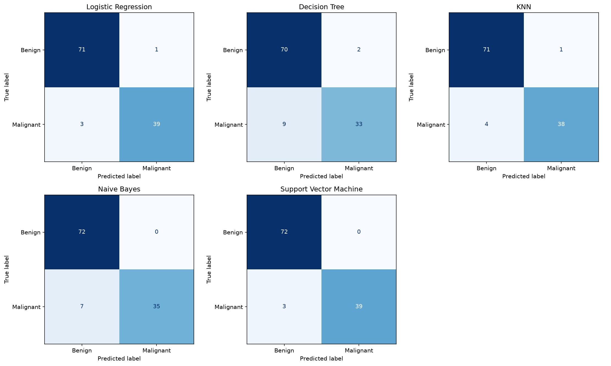

# Breast Cancer Classification — ML Assignment 2

**BITS ID:** 2026ak05270

## a. Problem statement

Build and compare five machine learning classifiers to classify breast tumour samples as benign or malignant using numerical measurements. Evaluate all models on the same held-out test set and provide a Streamlit application for evaluating uploaded labelled test data.

## b. Dataset description

The Breast Cancer Wisconsin (Diagnostic) dataset is from the UCI Machine Learning Repository and is loaded using scikit-learn's `load_breast_cancer`.

Source: https://archive.ics.uci.edu/dataset/17/breast-cancer-wisconsin-diagnostic

- Instances: 569
- Input features: 30 numerical features
- Missing values: 0
- Classes: 357 benign and 212 malignant
- Target encoding used here: 0 = benign; 1 = malignant

Features describe cell nuclei in digitised images of fine needle aspirates of breast masses. They include radius, texture, perimeter, area, smoothness, compactness, concavity, concave points, symmetry and fractal dimension, with mean, standard error and worst measurements.

The original scikit-learn labels are remapped so that malignant is the positive class.

### Data preparation

An 80:20 stratified split with `random_state=42` produces:

- Training set: 455 records
- Test set: 114 records — 72 benign and 42 malignant

StandardScaler is used for Logistic Regression, KNN and SVM. It is fitted only on training data through pipelines. Decision Tree and Gaussian Naive Bayes use the original feature values.

Each saved pipeline contains its classifier and any required preprocessing. The test CSV contains the original, unscaled features and the target column.

## c. GitHub repository link

https://github.com/SubhashiniSrinivas/2026ak05270-ml

## d. Models used

| Model                  | Configuration                                                        |
| ---------------------- | -------------------------------------------------------------------- |
| Logistic Regression    | StandardScaler; max_iter=2000; random_state=42                       |
| Decision Tree          | max_depth=5; min_samples_leaf=3; random_state=42                     |
| KNN                    | StandardScaler; n_neighbors=5                                        |
| Naive Bayes            | GaussianNB with default parameters                                   |
| Support Vector Machine | StandardScaler; RBF kernel; C=1.0; probability=True; random_state=42 |

### Evaluation results

All five models use the same training and test split. Precision, recall and F1 treat malignant (1) as the positive class. AUC is calculated from predicted probabilities for the malignant class.

| ML Model Name          | Accuracy |    AUC | Precision | Recall |     F1 |    MCC |
| ---------------------- | -------: | -----: | --------: | -----: | -----: | -----: |
| Logistic Regression    |   0.9649 | 0.9960 |    0.9750 | 0.9286 | 0.9512 | 0.9245 |
| Decision Tree          |   0.9035 | 0.9471 |    0.9429 | 0.7857 | 0.8571 | 0.7926 |
| KNN                    |   0.9561 | 0.9823 |    0.9744 | 0.9048 | 0.9383 | 0.9058 |
| Naive Bayes            |   0.9386 | 0.9934 |    1.0000 | 0.8333 | 0.9091 | 0.8715 |
| Support Vector Machine |   0.9737 | 0.9947 |    1.0000 | 0.9286 | 0.9630 | 0.9442 |

### Observations

| Model                  | Observation on this test set                                                                                                                          |
| ---------------------- | ----------------------------------------------------------------------------------------------------------------------------------------------------- |
| Logistic Regression    | Highest AUC (0.9960). Correctly identified 39 of 42 malignant samples, with three false negatives and one false positive.                             |
| Decision Tree          | Lowest recall, F1 and MCC among the five models. Missed nine malignant samples and produced two false positives.                                      |
| KNN                    | Correctly identified 38 of 42 malignant samples. Four false negatives and one false positive; accuracy and F1 were below Logistic Regression and SVM. |
| Naive Bayes            | Precision was 1.0000, with no false positives. However, seven malignant samples were missed, giving recall of 0.8333.                                 |
| Support Vector Machine | Highest accuracy, F1 and MCC. No false positives and three false negatives. Recall tied with Logistic Regression.                                     |

**Overall best model on this test split: SVM.** It correctly classified 111 of 114 samples and achieved the highest accuracy, F1 and MCC. Logistic Regression achieved the highest AUC. These results describe this particular held-out split.

### Confusion matrices

Rows represent actual labels and columns represent predicted labels.



## Running the application locally

Use Python 3.12 and install the dependencies:

```bash
python -m pip install -r requirements.txt
python -m streamlit run app.py
```

Upload test_data.csv in the app, select a model, and inspect its metrics and confusion matrix. The comparison table shows all five models. Evaluation results can be downloaded as CSV.

## Reproducing training

Install Jupyter in the same environment:

```bash
python -m pip install jupyter
python -m jupyter notebook
```

Open ML_Assignment_2.ipynb and run all cells from the project directory. This prepares the dataset, trains and saves all five models, and generates the evaluation results.

The saved pipelines include preprocessing where required. The app does not retrain models on uploaded data.
